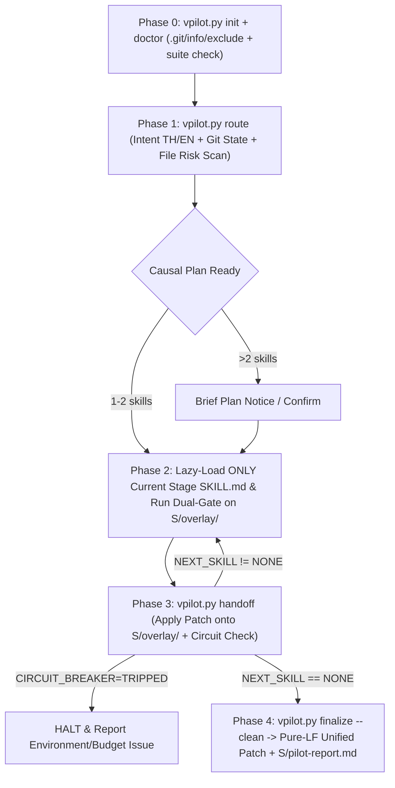

# VeriPilot (VeriHunt Suite) 🧭⚡

[](https://agentskills.io)
[](https://github.com/lufus4826-eng/veripilot/actions/workflows/ci.yml)
[](https://github.com/lufus4826-eng/veripilot/releases/tag/v1.0.1)
[](LICENSE)
[](#one-command-suite-installation)
[](#prerequisites)
[](#prerequisites)
[](https://github.com/lufus4826-eng/verihunt)

> **VeriPilot (VeriHunt Suite) — AI Coding Agent Skills Orchestrator, Smart Router, Cumulative Overlay Engine & One-Command Suite Installer.**  
> Stops users from guessing which verification skill to invoke (`/veripr`, `/verihunt`, `/verisec`, `/veriperf`), prevents AI context explosion via **Just-in-Time Skill Loading**, chains multi-stage fixes over a **Cumulative Overlay Workspace** (`S/overlay/`, enforced via `NEXT_TARGET_ROOT` & `NEXT_STAGE_ARGS`) without patch collisions, enforces **Causal Execution Order**, trips a **Circuit Breaker** immediately on broken test harnesses, and installs the entire 5-skill suite across 6 agent platforms in one command.

---

## Why VeriPilot?

As the VeriHunt Ecosystem grew into four specialized verification engines (**VeriPR**, **VeriHunt**, **VeriSec**, **VeriPerf**), chaining them manually created four friction points:
1. **Skill Selection Ambiguity:** Users shouldn't have to memorize which skill catches 1-hop ripples vs. IDOR vulnerabilities vs. $O(N^2)$ slowdowns—or know when a payment/auth edit silently needs security auditing too.
2. **Context Bloat from Preloading All Manuals:** Loading 4 sibling `SKILL.md` files upfront burns tens of thousands of tokens before running a single test.
3. **Wrong Execution Order & Patch Conflicts:** Tuning speed before fixing bugs or adding authorization checks wastes effort and produces colliding `.patch` files against the raw baseline.
4. **Fragmented Installation:** Installing and checking 5 separate repositories across Claude Code, Antigravity/Gemini CLI, Cursor, Windsurf, Roo Code, and Cline took repetitive cloning and path setup.

**VeriPilot (`v1.0.1`) enforces 4 Iron Engineering Laws inside `scripts/vpilot.py` (Python 3 stdlib only; `<= 12` lines output per command):**
1. **Just-in-Time Skill Loading:** `SKILL.md` (`< 120` lines) forbids preloading sibling skill manuals; the active stage's `SKILL.md` is opened only when that stage runs.
2. **Causal Execution Order (`veripr -> verihunt -> verisec -> veriperf`):** Correctness always runs before Security, and Security always runs before Performance.
3. **Cumulative Overlay Workspace (`S/overlay/`):** Stage $N+1$ verifies and patches on top of Stages $1..N$ inside `S/overlay/`, exporting a single conflict-free pure-LF unified patch (`S/patches/veripilot-unified.patch`) validated with `git apply --check`.
4. **Circuit Breaker (`HARNESS_BROKEN` / Budget Gate):** Immediately halts downstream stages (`CIRCUIT_BREAKER=TRIPPED`, `NEXT_SKILL=NONE`) if Stage 1 encounters a broken test harness (`SyntaxError`, `ModuleNotFoundError`, `ImportError`) or exceeds the 2-skill automatic budget without confirmation.

---

## 3-Layer Deterministic Router & 5-Phase Workflow



---

## Verified Live Showcase (`examples/fintech_pilot_demo`)

Execute all 4 end-to-end orchestration scenarios in one command via [`examples/fintech_pilot_demo/run_demo.py`](examples/fintech_pilot_demo/run_demo.py) (see [`sample-pilot-report.md`](examples/fintech_pilot_demo/sample-pilot-report.md)):

| Case ID | Scenario | Triage / Orchestration Behavior | Empirical Proof |
|---|---|---|---|
| **PILOT-1** | Broad TH pre-submit prompt on branch touching `payment_service.py` & `receipt_api.py` | 3-Layer router detects Git diff + `SEC_RISK=HIGH` -> chains `veripr -> verisec` | Fixes `calculate_fee` `None` ripple + `refund_payment` IDOR via `S/overlay/` into 1 pure-LF patch (`GIT_APPLY=OK`, `VERIFY_CMD=PASS`, `CLEAN`) |
| **PILOT-2** | Mixed causal-order prompt (`จูนความเร็ว เช็กช่องโหว่ และตรวจ PR`) | Reorders `veriperf,verisec,veripr` -> **`veripr -> verisec -> veriperf`** (`REORDERED=True`) | Chains ripple fix + IDOR guard + $O(N^2) \to O(N)$ ledger speedup in 1 unified patch applied cleanly via `git apply` |
| **PILOT-3** | Broken test syntax in Stage 1 (`test_broken_syntax.py`) | `handoff --check-cmd` catches `SyntaxError` | **`CIRCUIT_BREAKER=TRIPPED`** (`REASON=HARNESS_BROKEN`, `NEXT_SKILL=NONE`) — zero downstream tokens wasted |
| **PILOT-4** | Offline 6-platform install + `doctor` check | `install --platform all --offline-from ...` + `doctor` | `INSTALL_STATUS=OK` across all 6 platforms (5/5 skills each), `DOCTOR_STATUS=HEALTHY` |

```bash
git clone https://github.com/lufus4826-eng/veripilot.git
cd veripilot
python -B examples/fintech_pilot_demo/run_demo.py
```

---

## One-Command Suite Installation

### Prerequisites
- **Python 3.9+** (`python` on `PATH`; zero `pip` packages required)
- **Git** CLI (`git` on `PATH`)

### Install the Complete 5-Skill Suite in One Command
Once you have `veripilot`, install or update all 5 pinned suite skills (`veripilot@v1.0.0`, `veripr@v1.1.0`, `verihunt@v2.1.0`, `verisec@v1.1.0`, `veriperf@v1.1.1`) for your runtime:

```bash
# Google Antigravity / Gemini CLI (~/.gemini/config/skills/)
python scripts/vpilot.py install --platform antigravity

# Claude Code (~/.claude/skills/)
python scripts/vpilot.py install --platform claude

# All 6 platforms (Claude Code, Antigravity/Gemini CLI, Cursor, Windsurf, Roo Code, Cline)
python scripts/vpilot.py install --platform all

# Air-gapped / offline installation from a local folder
python scripts/vpilot.py install --platform all --offline-from /path/to/local_skills_bundle

# Optional: pull the latest vX.Y.Z release tag of each sibling skill instead of pinned versions
python scripts/vpilot.py install --platform antigravity --latest

# Verify Python, Git, and all 5 sibling skill engines
python scripts/vpilot.py doctor
```

---

## `scripts/vpilot.py` CLI Reference (All Commands `<= 12` Lines Output)

| Subcommand | Purpose |
|---|---|
| `init [--root .] [--skills-dir DIR]` | Creates `.bughunt/pilot-<ts>/{patches,logs,tmp,checkpoints,baseline,overlay}`, adds `.bughunt/` to `.git/info/exclude`, discovers sibling skills, snapshots `fs-before.txt`. |
| `route [--root .] [--s S] --prompt "..."` | Runs 3-layer triage (TH/EN Intent + Git status/merge-base + touched-file risk scan), enforces Causal Order (`veripr -> verihunt -> verisec -> veriperf`), returns `CURRENT_SKILL_MD`, `NEXT_TARGET_ROOT`, and `NEXT_STAGE_ARGS`. |
| `handoff --s S --skill <name> [--patch P \| --from-dir D] [--check-cmd C]` | Checks Circuit Breaker (`HARNESS_BROKEN` / `ENV_BROKEN` / `BUDGET_EXCEEDED_2_SKILLS`), applies stage edits onto `S/overlay/`, saves stage patch & checkpoint, returns `NEXT_SKILL_MD`, `NEXT_TARGET_ROOT`, and `NEXT_STAGE_ARGS`. |
| `finalize --s S [--clean] [--verify-cmd C]` | Exports pure-LF `S/patches/veripilot-unified.patch`, runs `git apply --check --ignore-space-change --ignore-whitespace`, cleans temps, verifies host `cleanliness`. |
| `install [--platform ...] [--offline-from DIR] [--latest]` | Clones or updates all 5 VeriHunt suite skills across 6 platforms (pinned release tags by default, or latest remote semver tags via `--latest`, or offline copy). |
| `doctor [--root .] [--skills-dir DIR]` | Audits Python `>=3.9`, Git, all 5 `SKILL.md` & CLI scripts, `.git/info/exclude`, and stale `.bughunt/` overlays. |
| `log --s S [--status ...] [--entry ...]` | Atomically updates `S/worklog.md`. |

---

## Veri-Suite Ecosystem

[-2ea44f.svg)](https://github.com/lufus4826-eng?tab=repositories&q=topic%3Averi-suite)

| Skill | Role in Causal Chain | Pinned Release | Repository |
|---|---|---|---|
| **VeriPilot** *(Current Repo)* | Hub, Smart Router, Cumulative Overlay & 1-Command Installer | `v1.0.1` | [`lufus4826-eng/veripilot`](https://github.com/lufus4826-eng/veripilot) |
| **VeriPR** | Stage 1a: Pre-Commit & PR Differential Guard (`1-hop` ripple + `schema_hash`) | `v1.1.0` | [`lufus4826-eng/veripr`](https://github.com/lufus4826-eng/veripr) |
| **VeriHunt** | Stage 1b: Deep Evidence-Based Bug Hunting & Sandbox Verifier | `v2.1.0` | [`lufus4826-eng/verihunt`](https://github.com/lufus4826-eng/verihunt) |
| **VeriSec** | Stage 2: Defensive AppSec, Authz Invariant & Air-Gapped PoC Verifier | `v1.1.0` | [`lufus4826-eng/verisec`](https://github.com/lufus4826-eng/verisec) |
| **VeriPerf** | Stage 3: Statistical Profiling (`p50`/`p95`, Peak RAM, `ABBA` Interleaving) | `v1.1.1` | [`lufus4826-eng/veriperf`](https://github.com/lufus4826-eng/veriperf) |

---

## License

Licensed under the **MIT License** — see [LICENSE](LICENSE).
